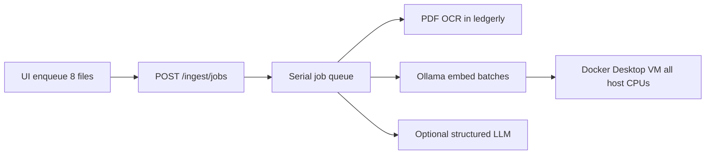

# Cool multi-file ingest without CPU explosion

## What happened

Jobs already run **one at a time**, but Docker Desktop gave the Linux VM (and Ollama inside it) access to all host cores. Sustained embed/OCR/structured LLM work drove **Virtual Machine Service for Docker to ~1270% CPU**. App-level sleeps alone cannot stop that without a **hard CPU ceiling**.

## Approach (committed)

Hard-cap Docker CPU for Ollama + app, make portable ingest pacing the default cooler path on this stack, and skip structured LLM during queued multi-file runs so bulk ingest spends time on extract+embed only.

### 1. Hard CPU limits in Compose

In [`docker-compose.yml`](docker-compose.yml):

- **`ollama`**: `cpus: "2.0"` (and matching `mem_limit` ~4g if practical) so llama.cpp cannot fan out across the whole machine.
- **`ledgerly`**: `cpus: "1.5"` so Tesseract OCR cannot race Ollama for every core.
- Keep `OLLAMA_NUM_THREADS` default at **2** in Compose (`${OLLAMA_NUM_THREADS:-2}`) so thread pool matches the cgroup, not half of a 12-core host.

`start.sh` auto-detect currently caps at 8 ([`app/cpu_defaults.py`](app/cpu_defaults.py)); lower that **cap to 4** and prefer Compose/env override so Docker Desktop Macs do not auto-pick 6–8.

### 2. Cooler ingest pacing defaults (portable / low_spec)

In [`app/config.py`](app/config.py), when `LEDGERLY_PROFILE=portable|low_spec`:

- `EMBED_INTER_BATCH_SLEEP_SEC` default **1.0** (today 0)
- `INGEST_QUEUE_INTER_JOB_SLEEP_SEC` default **8** (today 3)
- Keep `OLLAMA_MAX_CONCURRENT=1` and `OLLAMA_WARMUP_ENABLED` false via existing portable example

Update [`.env.portable-xps15.example`](.env.portable-xps15.example) and [`.env.example`](.env.example) to match; add a short Mac note pointing at the same knobs.

Ensure local `.env` uses `LEDGERLY_PROFILE=portable` when running via Docker on a laptop (config change / copy from example—not a code path fork).

### 3. Bulk-queue skips optional LLM (still gets tasks done)

In [`app/ingest_worker.py`](app/ingest_worker.py) / [`app/main.py`](app/main.py) `ingest_text`:

- When a job came from the **file queue** (`POST /ingest/jobs`), skip **structured** LLM extraction (`INGEST_STRUCTURED_ENABLED` path) for that job.
- Still do: extract → chunk → embed → save (documents usable in Ask/review).
- Single-file / text ingest keeps structured behavior unchanged.
- Surface in the job result that structured was skipped (`structured_skipped: true`) so the UI can say “ingested; track fields can be filled later” if useful—minimal UI text in the queue status line.

This removes 0–2 chat calls per file from an 8-file batch (major heat after embedding).

### 4. UI: honest progress, no false “frozen”

In [`static/index.html`](static/index.html):

- While `ingestQueueEnqueuing` or any job `running`/`pending`, keep drop zone usable for *selecting* next batch only up to remaining `INGEST_QUEUE_MAX`, and show a clear hint: “Cooling between files — CPU is capped; this is slower on purpose.”
- Wire poll interval to server hint if cheap (`INGEST_UI_POLL_INTERVAL_SEC`); otherwise leave 5s poll (not the heat source).

### 5. Docs one-liner

In [`setup_and_testing.md`](setup_and_testing.md) or [`docs/target-pc-dad-xps15.md`](docs/target-pc-dad-xps15.md): multi-file ingest on Docker Desktop Mac = portable profile + Compose CPU caps; expect slower batches; quit Docker when idle if fans matter.

## Out of scope

- Moving Ollama to native host-only (optional later; biggest architectural change).
- Parallel ingest (would make heat worse).
- GPU passthrough on Mac Docker (not available).

## Verify

1. `docker compose up -d`, Activity Monitor CPU: **Virtual Machine Service** stays well under prior ~12-core peg during an 8-file ingest (roughly ≤ ~200–300% with 2-CPU ollama + 1.5 app).
2. Queue still completes all files; Ask retrieval works on newly ingested docs.
3. Single-file ingest still runs structured extraction when regex needs LLM.
4. With `OLLAMA_NUM_THREADS=2` in env, `docker compose exec ollama printenv OLLAMA_NUM_THREADS` matches.