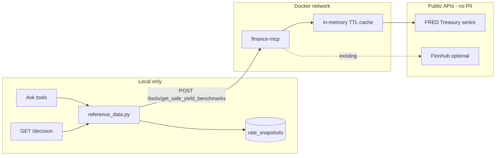

# Finance MCP: live safe-yield benchmarks (no PII)

## Problem

[`mcp-finance-tools`](mcp-finance-tools/main.py) only exposes compound interest and Finnhub stock quotes. Ledgerly's rate comparisons use **static** defaults in [`app/reference_data.py`](app/reference_data.py) (~4.15%–4.35%), and the VMFXX Finnhub hack returns NAV (~$1), not yield. Decision memos and Ask benchmark tools cannot say "your 4.85% vs ~5.1% market proxy."

## Approach

Extend the **existing** `finance-mcp` container (not `mcp-ledgerly`, which would expose user data). Add a FRED-backed rates module; wire the main app to call it over the Docker network. Fallback chain when FRED is unavailable: env overrides → static defaults.



## Privacy rules (enforced in design)

| What leaves the machine | What never leaves |
|---------------------------|-------------------|
| FRED: public series IDs (`DGS3MO`, `DGS6MO`, `DGS1`, `DGS2`) + API key | User questions, account names, principals, document text |
| Finnhub (optional): ticker symbol only | Institution names, holdings |

All MCP tool inputs are **generic numbers or public identifiers** — never user context.

## Phase 1 — New rates module in `mcp-finance-tools`

### 1a. Add [`mcp-finance-tools/tools/rates.py`](mcp-finance-tools/tools/rates.py)

FRED client using `https://api.stlouisfed.org/fred/series/observations` (same pattern as [`tools/market.py`](mcp-finance-tools/tools/market.py)).

**Series mapping** (Treasury constant maturity as CD-term proxy):

| `term_months` | FRED series | Label |
|---------------|-------------|-------|
| 3 | `DGS3MO` | 3-Month Treasury |
| 6 | `DGS6MO` | 6-Month Treasury |
| 12 | `DGS1` | 1-Year Treasury |
| 24 | `DGS2` | 2-Year Treasury |
| MMF proxy | `DGS3MO` | 3-Month T-bill proxy for money-market yield |

Response shape (normalized for Ledgerly):

```json
{
  "benchmarks": [
    {
      "product_type": "cd",
      "term_months": 12,
      "rate_apr": 4.82,
      "label": "1-Year Treasury (CD proxy)",
      "source_name": "FRED",
      "source_url": "https://fred.stlouisfed.org/series/DGS1",
      "as_of": "2026-07-07"
    }
  ],
  "mmf_proxy": { "rate_apr": 4.55, "label": "3-Month Treasury (MMF proxy)", ... },
  "source": "fred",
  "fetched_at": "2026-07-08T04:00:00Z"
}
```

**In-memory cache** inside the MCP server (`RATE_CACHE_TTL_SEC`, default 6 hours) so decision memos and Ask don't hammer FRED.

**Fallback**: if `FRED_API_KEY` missing or FRED errors, return `source: "curated_fallback"` with the same static tiers as today's [`DEFAULT_CD_BENCHMARKS`](app/reference_data.py) — server stays usable offline.

### 1b. Add two more local-only tools (useful, zero egress)

| MCP tool | Purpose |
|----------|---------|
| `get_safe_yield_benchmarks` | Primary deliverable — FRED + fallback |
| `compare_rate_delta` | `{user_rate_apr, benchmark_rate_apr, meaningful_delta?}` → delta, meaningful flag, summary text (mirrors [`compare_user_rate`](app/reference_data.py)) |
| `calculate_simple_interest` | Parity with [`app/ask_calculations.py`](app/ask_calculations.py) for CD interest questions |

Keep existing `calculate_compound_interest` and `get_stock_quote` unchanged.

### 1c. Register endpoints in [`mcp-finance-tools/main.py`](mcp-finance-tools/main.py)

Add `POST /tools/get_safe_yield_benchmarks`, `/tools/compare_rate_delta`, `/tools/calculate_simple_interest` with `operation_id` matching tool names (same `fastapi-mcp` pattern as today). Bump version to `0.3.0`. Update MCP description to lead with safe-yield benchmarks, not stock quotes.

### 1d. Config and Docker

- [`mcp-finance-tools/.env.example`](mcp-finance-tools/.env.example): add `FRED_API_KEY` (free: [FRED API key](https://fred.stlouisfed.org/docs/api/api_key.html)), `RATE_CACHE_TTL_SEC`
- [`docker-compose.yml`](docker-compose.yml): pass `FRED_API_KEY: ${FRED_API_KEY:-}` to `finance-mcp`
- [`.env.example`](.env.example): document `FRED_API_KEY` alongside `FINNHUB_API_KEY`

## Phase 2 — Wire Ledgerly app to MCP rates

### 2a. Refactor [`app/reference_data.py`](app/reference_data.py)

- Replace `_fetch_mmf_via_finance_tools()` (VMFXX NAV hack) with `_fetch_benchmarks_via_finance_tools()` calling `POST {FINANCE_TOOLS_BASE_URL}/tools/get_safe_yield_benchmarks`
- Map JSON response → existing `RateInfo` list (CD rows + MMF row with `rate_apr`)
- Update `fetch_cd_rates()` fallback chain:

```
1. MCP live benchmarks (if FINANCE_TOOLS_BASE_URL set)
2. REFERENCE_CD_RATES env override (unchanged)
3. DEFAULT_CD_BENCHMARKS static (unchanged)
```

- Tag `source_name` clearly: `"FRED via finance-mcp"` vs `"Ledgerly curated benchmark"` so memos cite the source
- Existing `rate_snapshots` cache ([`fetch_cd_rates_with_cache`](app/reference_data.py)) continues to work — live FRED data gets persisted for 24h

### 2b. Enable external benchmarks in Ask

In [`app/ask_tools.py`](app/ask_tools.py), change `_local_rate_infos()`:

```python
# Today: include_external=False (always static)
# After: include_external=bool(FINANCE_TOOLS_BASE_URL)
```

Update `_tool_get_cd_benchmark_rates` response to include `source` field (`fred` / `curated_fallback` / `local_curated`) so the LLM can caveat "Treasury proxy, not your bank's offer."

### 2c. Do **not** re-enable `finance_tools_client.py` LLM path

Rates flow through `reference_data.py` HTTP calls — no extra Ollama inference, no user question text sent to MCP. [`finance_tools_client.py`](app/finance_tools_client.py) stays disabled for CPU; stock-quote MCP remains available to Cursor clients only.

## Phase 3 — Tests and docs

### Tests

| File | Coverage |
|------|----------|
| `mcp-finance-tools/tests/test_rates.py` (new) | Mock FRED responses, cache hit, fallback when no key, compare_rate_delta |
| [`tests/test_reference_data.py`](tests/test_reference_data.py) | Mock MCP HTTP; verify `RateInfo` mapping and fallback |
| [`tests/test_ask_tools_unit.py`](tests/test_ask_tools_unit.py) | `get_cd_benchmark_rates` returns `source` when MCP mocked |

Add `scripts/spike_fred.py` (mirror [`scripts/spike_finnhub.py`](mcp-finance-tools/scripts/spike_finnhub.py)) for manual FRED verification.

### Docs

- [`mcp-finance-tools/README.md`](mcp-finance-tools/README.md) + [`CONNECTING.md`](mcp-finance-tools/CONNECTING.md): new tools, FRED key setup, privacy note
- [`mcp-finance-tools/TESTING.md`](mcp-finance-tools/TESTING.md): FRED spike + benchmark curl examples
- [`setup_and_testing.md`](setup_and_testing.md) section F: update expected benchmark answers to mention FRED Treasury proxies when key is set
- [`FINANCIAL-ASSISTANT.md`](FINANCIAL-ASSISTANT.md): add `FRED_API_KEY` to config table; clarify benchmarks are Treasury proxies, not institution CD offers

## Out of scope (intentional)

- **`mcp-ledgerly`** — exposes user documents/positions to external agents; separate privacy story
- **Bank-specific CD APY scraping** — ToS/paid API risk; Treasury proxies match product principles
- **Re-enabling Ask → finance MCP LLM intent** — CPU cost; rates wired via `reference_data` instead
- **Installer ZIP rebuild** — can follow after merge if needed

## Verification checklist

1. `FRED_API_KEY` set → `curl POST localhost:8001/tools/get_safe_yield_benchmarks` returns live Treasury yields with `source: "fred"`
2. No key / FRED down → same endpoint returns `source: "curated_fallback"` with static tiers
3. `GET /decision` with maturity trigger → memo compares user APY vs nearest FRED proxy; sources cite FRED
4. Ask: "What are current CD benchmarks?" → mentions Treasury proxy rates, not stale 4.35% defaults
5. Grep confirms no user question text or account fields in MCP request payloads
