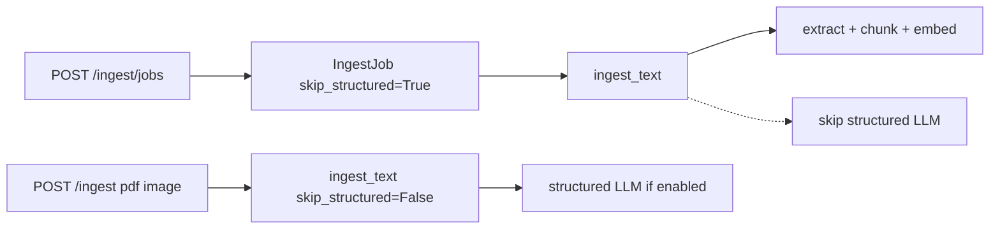

# Finish cool ingest items 1–3

Work is already present in the current tree for the core code paths. This plan is to **close remaining holes** so laptop Docker actually uses the cooler defaults, then verify.

Do **not** implement items 4–5 (cool queue hint copy, extra docs) unless you ask after this.

## Already done (keep; do not re-implement)

**Item 1 — Compose CPU caps** in [`docker-compose.yml`](docker-compose.yml): `ollama` has `cpus: "2.0"`, `mem_limit: 4g`, `OLLAMA_NUM_THREADS=${OLLAMA_NUM_THREADS:-2}`; `ledgerly` has `cpus: "1.5"`, `mem_limit: 2g`.

**Item 1 — auto-detect cap 4** in [`app/cpu_defaults.py`](app/cpu_defaults.py) (`min(..., 4)`). Tests in [`tests/test_cpu_defaults.py`](tests/test_cpu_defaults.py) already expect cap 4 on 8- and 16-core hosts.

**Item 2 — portable sleep defaults** in [`app/config.py`](app/config.py): when `LEDGERLY_PROFILE` is `portable` or `low_spec`, unset env falls back to embed sleep `1` and queue sleep `8`. [`/.env.portable-xps15.example`](.env.portable-xps15.example) already sets those values plus `OLLAMA_NUM_THREADS=2`.

**Item 3 — skip structured on queue jobs:** [`IngestJob.skip_structured`](app/ingest_jobs.py) defaults to `True`. [`POST /ingest/jobs`](app/main.py) does not override it, so every queued file job skips. [`ingest_worker`](app/ingest_worker.py) passes `skip_structured` into `ingest_text` and sets `result.structured_skipped`. Direct `POST /ingest`, `/ingest/pdf`, `/ingest/image` still call `ingest_text` with default `skip_structured=False`. Test: [`tests/test_ingest_queue_skip_structured.py`](tests/test_ingest_queue_skip_structured.py).

## Remaining work

### 1. Stop `.env.example` from undoing portable pacing

[`/.env.example`](.env.example) still **sets** `EMBED_INTER_BATCH_SLEEP_SEC=0` and `INGEST_QUEUE_INTER_JOB_SLEEP_SEC=3`. Anyone who copies this file (or already has those keys in `.env`) never gets the portable 1s/8s defaults from `config.py`.

Change: comment those two assignments (keep the existing comments that explain portable defaults). Explicit values remain in [`.env.portable-xps15.example`](.env.portable-xps15.example).

Do **not** edit the live `.env` (secrets). After merge, if your `.env` still has `=0` / `=3`, delete those two lines or copy the portable example so Docker on the laptop actually cools down.

### 2. Small test for portable sleep defaults

Add tests (same file as skip-structured or a tiny `tests/test_cpu_pacing_defaults.py`) that import `app.config` with `LEDGERLY_PROFILE` set via monkeypatch **before** import is awkward because config is module-level.

Practical approach: extract the two default-string helpers already inlined in [`app/config.py`](app/config.py) into tiny functions, e.g. `default_embed_inter_batch_sleep(profile)` / `default_ingest_queue_sleep(profile)`, and unit-test those (portable → 1 / 8, otherwise → 0 / 3). Keep `os.getenv` wiring as today.

### 3. Confirm skip-structured only on the queue

No extra API flag needed. Optional one-liner in the skip-structured test: constructing `IngestJob(...)` without `skip_structured` yields `True`. Direct ingest paths already omit the flag.

Leave UI `structured_skipped` copy as-is (already in [`static/index.html`](static/index.html)); that is item 4 polish, already present.

### Out of scope for this pass

- Recreating [`installer/output/Ledgerly/`](installer/output/Ledgerly/) (stale compose still has `OLLAMA_NUM_THREADS:-4` and no cpus limits). Sync only if you are cutting a portable ZIP.
- Recreating Docker containers (needed on your machine after compose change: `docker compose up -d` so cgroup limits apply).
- Items 4–5 beyond what is already in the tree.

## Verify

- `pytest tests/test_cpu_defaults.py tests/test_ingest_queue_skip_structured.py` plus the new pacing-default tests.
- Optional: `docker compose exec ollama printenv OLLAMA_NUM_THREADS` expects `2` when unset in `.env`.
