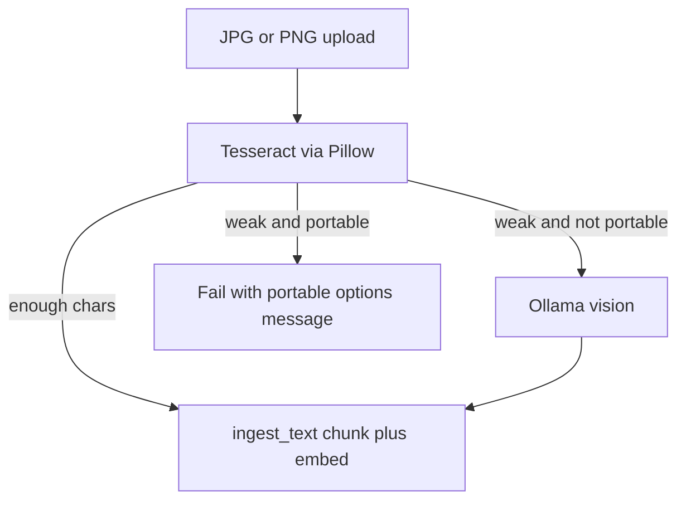

# Cool PNG/JPG ingest via OCR

## Why not a bigger vision model

Portable already uses `moondream` to stay cool. Switching to `llava:7b` would **increase** heat and RAM. The screenshot is high-contrast UI text; **Tesseract in the app container** is the right tool (same stack PDFs already use). Embeddings still go to Ollama after extract; that is the existing cool-ingest path (batch sleep + CPU caps).

## Extract helper

Add `extract_image_bytes_for_ingest(raw: bytes) -> str` in a small module (prefer [`app/image_ingest.py`](app/image_ingest.py) so [`app/pdf_ingest.py`](app/pdf_ingest.py) stays PDF-only).

- Open bytes with Pillow (`Image.open(io.BytesIO(raw))`).
- `pytesseract.image_to_string` (same as PDF OCR).
- Treat result as strong if `len(text.strip()) >= PDF_OCR_MIN_CHARS` (reuse [`app/config.py`](app/config.py); default 10). If `PDF_OCR_ENABLED` is false, skip OCR and behave as weak.
- **Portable / low_spec** (`LEDGERLY_PROFILE`): never call `image_to_text_for_ingest`. If OCR is weak or Tesseract errors, raise a `ValueError` with the copy below (queue UI already shows `job.error` on Failed; `POST /ingest/image` should use the same string in the HTTP 400 detail).
- **Other profiles**: if OCR is weak, then call existing `llm_client.image_to_text_for_ingest` (current behavior as fallback).

## Portable user message (required)

Say they are on **portable** (or **low_spec**) so vision was skipped to keep the machine cool. OCR could not read enough text (blurry, tiny, or non-text). Then list options, newline-separated so [static/index.html](static/index.html) `pre-wrap` error boxes stay readable:

1. **Paste** the visible text into Ingest (no image).
2. **Retake** a sharper screenshot, crop to the numbers/labels, avoid extra UI chrome.
3. **Leave portable** if they accept more heat: remove or comment `LEDGERLY_PROFILE=portable` in `.env`, restart, retry so vision can run as fallback. Point at [`.env.portable-xps15.example`](.env.portable-xps15.example) / [docs/target-pc-dad-xps15.md](docs/target-pc-dad-xps15.md) only in the docs sentence, not a long dump in the toast.

Keep the message under ~8 short lines. Constant in `app/image_ingest.py` so the test can assert substrings (`portable`, `paste`, `screenshot`, `LEDGERLY_PROFILE` or “leave portable”).

Optional: convert to RGB before Tesseract so palette/alpha PNGs do not fail.

## Call sites

Replace the vision-only extract in:

- [`app/ingest_worker.py`](app/ingest_worker.py) (`IngestJobKind.IMAGE` branch, currently lines 134–142)
- [`app/main.py`](app/main.py) `POST /ingest/image` (currently lines 830–842)

Keep magic-byte / 10 MB checks as they are. Keep the existing `< 10` empty-text failure after extract.

Do **not** recreate [`installer/output/Ledgerly/`](installer/output/Ledgerly/).

## Tests

New [`tests/test_image_ingest.py`](tests/test_image_ingest.py):

- OCR returns a long string → vision **not** called.
- Portable profile + short OCR → vision **not** called, raises; error text mentions portable and the three options.
- Non-portable + short OCR → vision **is** called.

Patch `pytesseract` / Pillow and `image_to_text_for_ingest`; no live Ollama.

## Docs (minimal)

One sentence in [`setup_and_testing.md`](setup_and_testing.md) where it currently says JPG/PNG always use the vision model: OCR first; vision fallback only when not portable/low_spec.
